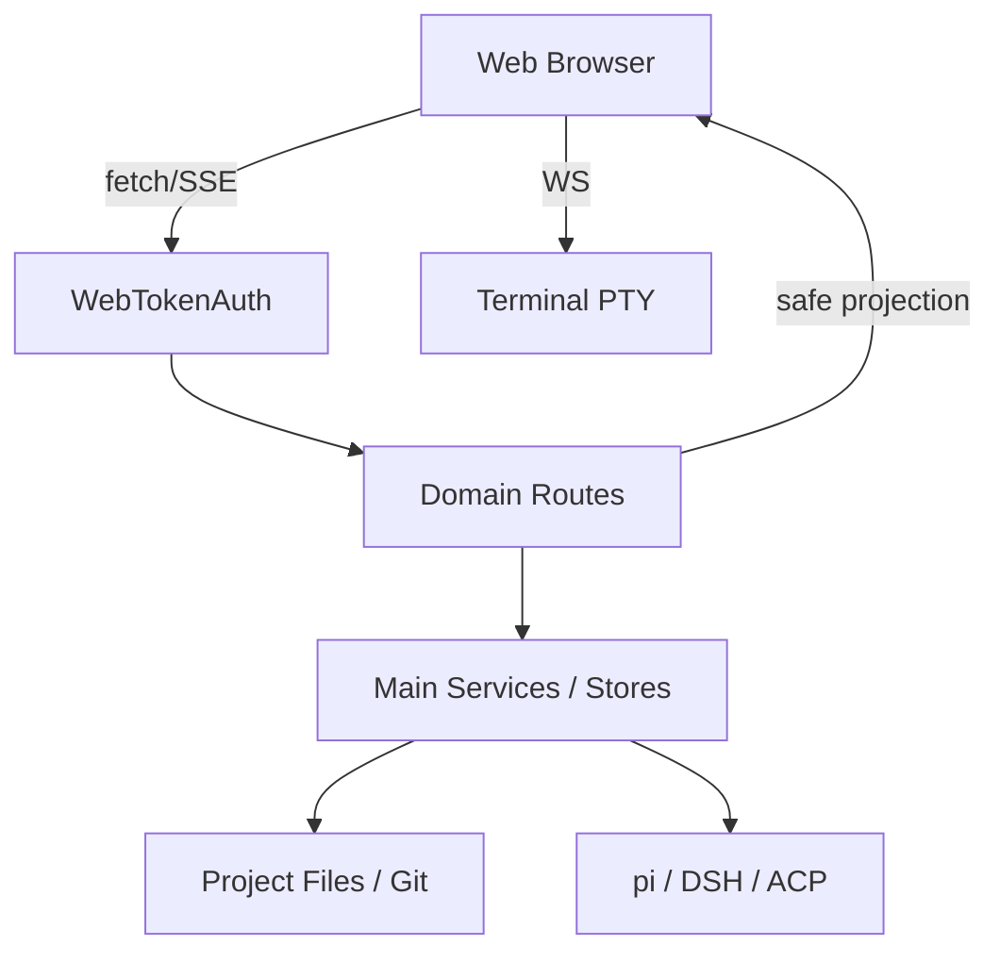

# Design: PiDeck Web 与桌面端页面/功能对齐

> Requirements: @requirements.md
> Status: Draft → Approved（用户 2026-11-07 指示先落 spec 后继续）
> Last Updated: 2026-11-07

## 1. Executive Summary

在不新增 pi↔PiDeck 通道、不把浏览器变成宿主控制通道的前提下，把 Web 端从「聊天 + 只读工作区」扩展为完整工作台。实现策略：

1. **路由按域拆**：`WebWorkspaceRoutes` 继续承载工作区写能力；新增 `WebSettingsRoutes`、`WebTerminalRoutes` 等独立模块，统一走 `WebTokenAuth` 与 `WebHttpResponders`。
2. **能力复用**：设置走 `SettingsStore` 白名单投影；文件走 `FileSystemService`；Git 走 `GitService`；终端走 `TerminalSessionManager`；自动化/智能体/收藏走既有 Store/Service。
3. **写操作分阶段**：Phase 1 只开放低风险写（设置白名单、项目内文件管理、Git 分支/commit）；终端 Phase 2 且默认关闭；远程/插件 Phase 4。
4. **前端按域拆组件**：`WebChatApp` 只保留组合根；设置、终端、自动化等各自页面/抽屉，避免继续膨胀。

## 2. Requirements Mapping

| Requirement | Design Coverage | Notes |
|-------------|-----------------|-------|
| FR-001 多标签 | 已交付；§4.1 | 纯 renderer + localStorage |
| FR-002 工作区抽屉 | 已交付；§4.1 | 文件/Git/草稿本 |
| FR-003 文件编辑 | 已交付；§4.2 | mtime 冲突 + 2MB |
| FR-004 草稿本 | 已交付；§4.2 | ScratchPadService |
| FR-005 Git 最小写入 | 已交付；§4.3 | stage/unstage/commit |
| FR-006 设置 | §4.4 / TD-001 | 白名单投影 |
| FR-007 文件管理 | §4.2 / TD-002 | 回收站 + 边界 |
| FR-008 Git 分支 | §4.3 / TD-003 | 切换前状态检查 |
| FR-009 命令面板 | §4.5 | 纯 renderer |
| FR-010 终端 | §4.6 / TD-004 | 默认关闭 + WebSocket |
| FR-011 分屏/状态 | §4.7 | Phase 2 |
| FR-012 自动化 | §4.8 | 复用 AutomationStore |
| FR-013 智能体 | §4.8 | 复用 AgentProfileStore |
| FR-014 收藏 | §4.8 | 复用 FavoritesStore |
| FR-015 生图/视频 | §4.8 | Phase 3 |
| FR-016 远程/WSL/Worktree | §4.9 | Phase 4 |
| FR-017 通知/公告/反馈 | §4.9 | Phase 4 |
| FR-018 PWA/移动 | §7 | 每阶段 E2E |
| FR-019 安全 | §6 | 所有写路由 |
| FR-020 宿主插件 | §4.9 | 只读投影 |

## 3. System Architecture

### Component Overview

| Component | Responsibility | Boundaries | Notes |
|-----------|----------------|------------|-------|
| `WebChatApp` | 组合根：会话、流、标签、抽屉、覆盖层 | 不持有领域规则 | 净增长受控 |
| `WebSessionTabs` | 标签渲染/切换/关闭 | 纯 UI | 逻辑在 `webSessionTabs.ts` |
| `WebWorkspaceDrawer` | 工作区壳 + 面板切换 | 不直接 fetch | 面板各自加载 |
| `WebFilesPanel` | 文件树/筛选/导航 | 只读导航 | 文件操作 Phase 1 |
| `WebGitPanel` | 分支/变更/diff/log + stage/commit | 不开放 discard/push | 分支 Phase 1 |
| `WebNotesPanel` | 草稿本 | 复用 ScratchPadService | 已有 |
| `WebFileEditor` | 文本编辑/冲突 | 只项目内文本 | 已有 |
| `WebSettingsPanel`（新） | 设置分组/表单 | 只白名单字段 | Phase 1 |
| `WebCommandPalette`（新） | 命令搜索/执行 | 纯 renderer | Phase 1 |
| `WebTerminalDock`（新） | xterm 会话 | 默认关闭 | Phase 2 |
| `WebAutomationPage`（新） | 定时任务 | 复用 store | Phase 3 |
| `WebAgentsPage`（新） | 智能体 | 复用 store | Phase 3 |
| `WebFavoritesPage`（新） | 收藏 | 复用 store | Phase 3 |
| `WebSettingsRoutes`（新） | 设置投影/白名单写 | 不暴露 secrets | Phase 1 |
| `WebWorkspaceRoutes` | 文件/Git/草稿本 | 路径边界 | 扩展 |
| `WebTerminalRoutes`（新） | PTY 桥 | token + 会话归属 | Phase 2 |
| `WebAutomationRoutes`（新） | 自动化 CRUD | 复用 store | Phase 3 |
| `WebAgentRoutes`（新） | 智能体 CRUD/invoke | 复用 store | Phase 3 |
| `WebFavoritesRoutes`（新） | 收藏 CRUD | 复用 store | Phase 3 |

### Data / Control Flow

## 4. Implementation Design

### 4.1 工作台壳（已交付）

- `WebChatApp` 新增状态：`openTabIds`（localStorage `pideck-web-tabs`）、`workspaceOpen`。
- 标签纯函数在 `webSessionTabs.ts`；关闭后右邻优先、其次左邻；裁剪保留当前激活项。
- 工作区抽屉桌面 `aside`（20–30rem）、移动全屏；面板状态 localStorage `pideck-web-workspace-panel`。

### 4.2 文件编辑与文件管理

**已交付：** `GET/POST /api/file-content`；`WebFileEditor`；mtime 冲突 409；2MB 上限；项目内相对路径。

**Phase 1 新增：**

| Method | Path | Purpose | Request | Response |
|---|---|---|---|---|
| POST | `/api/files/create` | 新建文件/目录 | `{projectId, dir, name, kind:"file"\|"directory"}` | `{node}` |
| POST | `/api/files/rename` | 重命名 | `{projectId, path, newName}` | `{node}` |
| POST | `/api/files/delete` | 删除到回收站 | `{projectId, path, recursive?}` | `{ok:true}` |

实现：`FileSystemService.create/rename/delete`（与桌面 `filesIpc` 同一实现）；路由层校验名称（禁止 `/ \ .. NUL`、长度 ≤255）、路径在项目内、目标不存在（create）或存在（rename/delete）、拒绝删除项目根；删除走回收站；返回结构化错误码。

### 4.3 Git 分支与写操作

**已交付：** `GET /api/git/status|diff|log`；`POST /api/git/stage|unstage|commit`。

**Phase 1 新增：**

| Method | Path | Purpose | Request | Response |
|---|---|---|---|---|
| GET | `/api/git/branches` | 分支列表 | `?projectId=` | `{repo, current, branches}` |
| POST | `/api/git/checkout` | 切换/新建并切换 | `{projectId, branch, create?}` | `{branch}` |
| POST | `/api/git/fetch` | fetch | `{projectId}` | `{ok:true}` |

> pull/push 未在 Phase 1 开放（TD-003）：需要凭据与误推风险独立评审，Phase 1.5 再补（原草案表格里的
> `/api/git/pull|push` 不再作为 Phase 1 交付项）。

规则：branch 必须来自当前分支列表或通过合法命名校验；checkout 前读取 status，有未提交改动时返回 409 + 可读原因；fetch 超时 120s，错误结构化；不记录凭据。

### 4.4 设置投影与白名单（已交付）

**实施后的白名单**（`src/main/web/WebSettingsProjection.ts` 是唯一事实来源，契约类型在
`src/shared/types/settings.ts` 的 `SafeWebSettings` / `WebWritableSettings`）：

- 外观：`theme`、`fontSize`、`uiFontSize`、`chatFontSize`
- 会话默认：`defaultAgentBackend`（只收 `pi` / `dsh`；写入时同置 `defaultAgentBackendManual`）
- 输入行为：`sendShortcut`、`expandInterimDuringStream`
- 只读附带：`themeScheduleLightStart` / `themeScheduleDarkStart`（Web 端解析 `theme=schedule` 需要；
  设置面板不提供时间编辑），`processGroupDisplay` 不开放（Web 时间线恒按回合聚合展示）。

**与草案的差异（先减后加）**：`themeStyle` / `themePalette` / `accent` / `customTheme*` 不下发也不可写。
Web 页有独立的视觉 token（`web.css` 覆盖 foundation 的 `--color-*`），同时落 `data-appearance`/
`data-palette` 会按选择器优先级互相压盖，用户看到的是「换了一半」的外观。字号与明暗是两端同源的
（`foundation.css` 的 `data-theme` / `data-*-font-size` dataset），所以只开放这三项 + 明暗。
`language` 暂不开放：Web 端 i18n 在启动时按浏览器语言解析，改了不会热生效，开放等于给假开关。

**禁止**：`webServiceToken*`、`webServiceRequiresAuth`、`security*`、`cua*`、`acpTools`、`piAuth*`、
`wsl*`、`remote*`、`plugins*`、`allowAcpInvoke`、`terminal*`、路径/密钥类字段。

API：`GET /api/settings` 返回 `{settings: SafeWebSettings}`；`POST /api/settings` 只接受白名单键，
未知键 400（不静默忽略、不部分写入）、非法值 400、空 body 400、非法 JSON 400、超 32KB 413，
返回更新后的投影。写入沿用 `SettingsStore.update`；装配层 `createWebSettingsRoutes` 负责
「明暗重放（nativeTheme）+ 向所有窗口广播既有 `settings:apply-window` 通道」（渲染层把该通道当
设置同步点，不新增第二条 IPC）。

前端：`useWebSettings`（组合根唯一投影）→ `WebSettingsDialog`/`WebSettingsPanel`；`theme` 以服务端
为权威来源（localStorage 仅首帧缓存），`sendShortcut` 接进 WebComposer 的 `getComposerEnterIntent`，
`expandInterimDuringStream` 接进 WebTimeline 过程组自动展开。

### 4.5 命令面板（已交付）

- 纯 renderer，三层拆分：`webCommands.ts`（过滤/排序/分组/循环索引，纯函数）、
  `webCommandList.ts`（命令清单装配 `buildWebCommands` + `useWebCommands`）、
  `WebCommandPalette.tsx`（Dialog + 键盘 + 焦点，快捷键监听也挂在组件内）。
- 快捷键：`Ctrl/Cmd+Shift+P`（面板内再按一次 = 关闭）；保留 `Ctrl/Cmd+K` 会话内搜索。
- 命令：新建会话、关闭当前标签、最近会话切换（按更新时间取前 8 条）、打开文件/Git/草稿本面板、
  关闭工作区、打开设置、切换明暗、会话内搜索、刷新模型、安装 PWA（可用时）。
  复制会话/导出未进面板：它们走头部 ⋮ 菜单的会话动作组，避免同一动作两处维护。
- 无障碍：`role=listbox`+`role=option`、`aria-activedescendant`、↑/↓/Home/End/Enter/Esc、
  打开即聚焦输入框、选中项自动滚入视口、关闭后再执行命令（避免同帧两个模态抢焦点）。

### 4.6 终端（Phase 2）

- 新增设置 `webTerminalEnabled`（默认 false）与 UI 开关；未开启时路由 404/403。
- 通道：`/api/terminal` WebSocket。握手校验 token（query，EventSource/WS 无法带 header）、项目/会话归属、终端开关；升级后只转发 JSON 帧 `{type:"input"|"resize"|"close", ...}`。
- 主进程：复用 `TerminalSessionManager`（node-pty），cwd 由会话/项目解析；不接受任意 cwd；输出只回该连接；close/退出/服务停止清理。
- 渲染层：复用 xterm.js；单会话多终端；移动端虚拟键盘；断线提示。
- 安全：不开放任意 shell 选择（只列 `terminalShells` 白名单）；不做命令解析/拼接；限制并发/帧率/输出缓冲。

### 4.7 分屏/状态面板（Phase 2）

- 分屏：`openTabIds` 之外维护 `splitSessionId`；桌面左右两栏，移动端只保留单栏（显式切换）。
- 状态/活动：复用 `listSessionSubagents`/`listSessionTodo`/context usage；抽屉底部或侧栏。
- 不引入第二个全局状态库；继续用组件状态 + refs。

### 4.8 自动化/智能体/收藏/生图（Phase 3）

- 路由复用既有 Store/Service：`AutomationStore`、`AgentProfileStore`、`FavoritesStore`、imagegen/videogen 链路。
- 页面以列表 + 详情/编辑器为主；写操作带确认；运行历史分页。
- 生图/视频：供应商配置只在主进程；Web 只传 prompt/参数/参考图，产物经既有文件 URL 或 data URL 受控返回。

### 4.9 远程/WSL/Worktree、通知/公告/反馈、宿主插件（Phase 4）

- 远程/WSL/Worktree：当前 Web `listProjects` 只返回本地项目；开放前先扩展 locator 投影与路径/权限边界，单独评审。
- 通知/公告/反馈：复用 `NoticeHistoryStore`、`AnnouncementService`、feedback 链路；反馈新建会话走既有 `createSessionDraft`。
- 宿主插件：只读安全投影；安装/执行/权限提升不在 Web 开放。

## 5. Integration Points

| System | Purpose | Auth / Permissions | Failure Handling |
|--------|---------|--------------------|------------------|
| `WebTokenAuth` | 所有 `/api/*` 鉴权 | Bearer/query token | 401 + 前端重新扫码提示 |
| `SettingsStore` | 设置读写 | 白名单 | 400/409 + 原文案 |
| `FileSystemService` | 文件管理 | 项目根 + 回收站 | 403/404/409 |
| `GitService` | Git 操作 | 项目仓库 + 分支校验 | 400/409 + stderr 脱敏 |
| `TerminalSessionManager` | PTY | 开关 + 会话归属 + token | 关闭连接 + 日志 |
| `AutomationStore` / `AgentProfileStore` / `FavoritesStore` | 页面数据 | 复用 IPC 语义 | 结构化错误 |

## 6. Security / Permissions / Privacy

- **Authentication:** 默认 `webServiceRequiresAuth=true`；WS/SSE 用 query token；令牌轮换后旧连接失效。
- **Authorization:** 每个写路由校验 `projectId` 存在且为本地项目；会话/终端校验 `sessionId` 归属。
- **Input validation:** 类型/长度/枚举/路径；拒绝未知字段；文件/草稿/消息大小上限。
- **Sensitive data:** 设置投影不含 token/密钥/凭据/宿主绝对路径；日志脱敏；Git stderr 截断。
- **Abuse cases:** 路径穿越、symlink 逃逸、CSRF（SameSite/Origin）、暴力 token、超大 body、终端并发、SSE 长连接耗尽。
- **Rate limits:** 写路由按 token/IP 限速；SSE/WS 每 token 连接上限。

## 7. UX / Accessibility

- 桌面：左列表 / 中会话 / 右工作区；窄屏抽屉优先折叠。
- 移动：单列，工作区全屏，底部安全区，触控 ≥32px。
- 键盘：命令面板、Esc 关闭、Ctrl/Cmd+S 保存、方向键导航。
- 状态：加载骨架、空态、错误横幅、冲突卡片、离线提示、保存反馈。
- 动效：120/200/320ms；尊重 `prefers-reduced-motion`；只动 transform/opacity。

## 8. Edge Cases

| Case | Expected Behavior |
|------|-------------------|
| 设置字段未知/非法 | 400，返回字段名；不部分写入 |
| 新建同名文件 | 409，不覆盖 |
| 重命名目标已存在 | 409，不覆盖 |
| 删除项目根 | 400 |
| 删除文件回收站不可用 | 500 + 可读错误；不硬删 |
| Git 切换时有未提交改动 | 409 + 提示先提交/暂存 |
| 分支名非法 | 400 |
| push/pull 无远端/凭据 | 400 + stderr 摘要 |
| 终端未开启 | 403/404 |
| 终端会话已删除 | 关闭连接 + 提示 |
| 移动端 390px | 无横向溢出 |

## 9. Impact Analysis

| Component | Impact Type | Description and Risk | Required Action |
|-----------|-------------|----------------------|-----------------|
| `WebChatApp.tsx` | modified | 新增设置/终端/命令面板入口 | 只加装配；新逻辑放新模块 |
| `WebWorkspaceRoutes.ts` | modified | 文件/Git 写路由增加 | 保持顺序与边界；新增测试 |
| `WebServiceManager.ts` | modified | 新 deps/路由注入 | 不改生命周期 |
| `main/index.ts` | modified | 新能力装配 | 不净增长；抽模块 |
| `shared/types/settings.ts` | maybe | 新 Web 设置类型 | 按域放；不反向依赖 |
| `i18n` | modified | 新文案 | 三语同步 + 生成 zh-TW |
| `e2e` | new | 设置/文件/Git/终端 | 新 spec + 端口隔离 |

## 10. Development Sequencing

1. 设置投影 + 白名单写（无依赖）。
2. 文件管理（依赖 §4.2 边界与 `FileSystemService`）。
3. Git 分支（依赖 §4.3；先只读/切换，push/pull 后置）。
4. 命令面板（纯 renderer，可与 1–3 并行）。
5. 移动端精修 + 测试（依赖 1–4）。
6. 终端（独立安全评审）。
7. 分屏/状态。
8. 自动化/智能体/收藏/生图。
9. 远程/通知/插件。
10. 全量 E2E + 部署。

## 11. Testing / Verification Strategy

### Unit / Component

- 设置白名单：未知字段拒绝、允许字段透传、投影不含 secrets。
- 文件管理：路径穿越、同名、项目根、回收站失败。
- Git 分支：非法分支、脏工作区、超时错误。
- 命令面板：过滤/分组/快捷键纯函数。
- 终端：开关、token、会话归属、帧校验。

### Integration / API

- `WebSettingsRoutes` / `WebWorkspaceRoutes` / `WebTerminalRoutes` 假 deps 测试。
- 鉴权链：401/403；body 上限；CORS。

### E2E / Manual

- 设置：改主题/字号 → 刷新保持 → 非法字段被拒。
- 文件：新建/改名/删除 → 文件树刷新 → 磁盘/回收站。
- Git：切分支 → 脏工作区提示 → fetch。
- 终端（Phase 2）：开启 → 打开 → 输入 `pwd` → 关闭 → 进程清理。
- 移动端 390px：无横向溢出。

### Project Verification

- Lint/format: `npm run check:format`
- Typecheck: `npm run typecheck`
- Test: `node --test tests/<相关>.test.mjs`
- Build: `npx electron-vite build`（只跑涉及子构建）
- E2E: `npx playwright test e2e/<相关>.spec.ts`

## 12. Observability / Operations

- 写操作日志：`web-settings`、`web-files`、`web-git`、`web-terminal` 命名空间；只记操作类型/项目/结果，不记正文/凭据。
- 失败指标：401/403/409/413 计数；终端连接数；SSE 连接数。
- 排障：`/api/health`、`webServiceManager.getStatus()`、主进程日志。

## 13. Migration / Rollout

- 设置：新增字段用默认值兜底；不改旧字段语义。
- 文件/Git：无数据迁移；Git 分支操作不改变仓库状态，除非用户显式切换。
- 终端：新设置默认 false；开启后按需创建 PTY。
- 回滚：关闭终端设置/停用新路由；数据无 schema 变更。

## 14. Technical Decisions

### TD-001: 设置用白名单投影，不用「屏蔽黑名单」

- **Decision:** 显式 allowlist，未知键 400。  
- **Why:** 新设置默认安全；漏掉一个高风险字段不会自动暴露。  
- **Trade-off:** 新设置需要显式加入 allowlist。  
- **Alternatives:** 黑名单（漏一个就提权）；直接复用桌面全量设置（泄露 secrets）。

### TD-002: 文件删除走回收站，不硬删

- **Decision:** 复用 `trashPath`/`FileSystemService.delete`；失败不降级。  
- **Why:** 用户内容可恢复；与桌面一致。  
- **Trade-off:** 回收站不可用时删除失败。  
- **Alternatives:** 硬删（不可接受）。

### TD-003: Git push/pull 后置到 Phase 1.5

- **Decision:** Phase 1 只做分支列表/切换/新建/fetch；push/pull 需要确认与凭据处理，单独评审。  
- **Why:** 降低误推/凭据泄露风险。  
- **Trade-off:** Web 端暂时不能完成远端推送。  
- **Alternatives:** 一次全开（风险高）。

### TD-004: 终端默认关闭 + WebSocket + 会话归属

- **Decision:** 独立开关；WS 握手校验 token/会话/项目；只转发输入/尺寸/关闭。  
- **Why:** PTY 是最高风险面；默认关闭可避免误暴露。  
- **Trade-off:** 用户需先在桌面开启。  
- **Alternatives:** 默认开启（不可接受）；只读命令面板（能力不足）。

## 15. Known Risks

| Risk | Likelihood | Impact | Mitigation |
|------|------------|--------|------------|
| 设置白名单漏字段 | Medium | High | allowlist 单测 + 代码审查 |
| 文件操作 symlink 逃逸 | Low | High | realpath 边界 + 测试 |
| Git 分支名注入 | Low | Medium | 分支列表/正则校验 + argv 数组 |
| 终端 PTY 逃逸 | Low | High | 开关 + token + 会话归属 + 清理 |
| 移动端布局回归 | Medium | Medium | 390px E2E + 触控目标 |
| Web 巨文件回涨 | Medium | Medium | 新模块拆分 + 行数检查 |

## 16. Implementation FAQ

**Q:** 设置能否直接复用桌面 `settings:update` IPC 的字段？  
**A:** 不能。Web 必须用独立白名单投影；桌面 IPC 仍服务桌面。

**Q:** 文件管理是否支持远端/WSL 项目？  
**A:** Phase 1 只支持本地项目；远端在 Phase 4 按 locator 开放。

**Q:** Git push/pull 为什么不在 Phase 1？  
**A:** 需要凭据/确认/超时/错误脱敏的独立评审；先做 fetch + 分支切换。

**Q:** 终端为什么不用 SSE？  
**A:** 双向交互 + resize + 二进制/高频输出更适合 WebSocket；SSE 只做输出会打断输入通道。

## 17. Open Questions

- 设置页第一版是否包含供应商登录/模型目录更新？（默认不包含）
- Git push/pull 是否在 Phase 1.5 开启？
- 终端是否需要移动端专用快捷键条？
