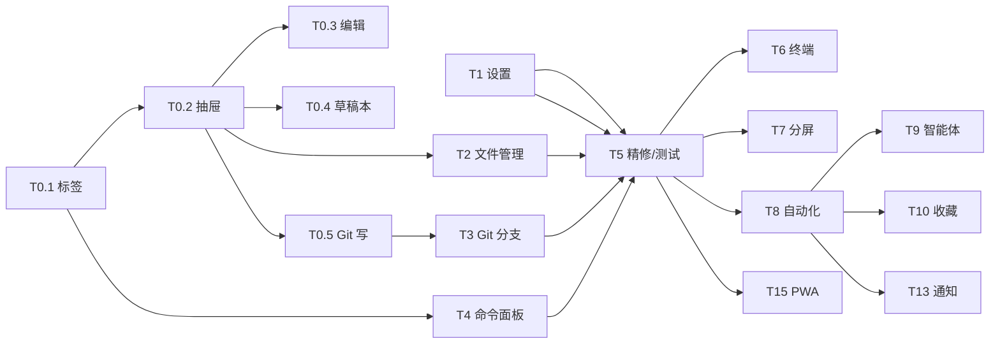

# Tasks: PiDeck Web 与桌面端页面/功能对齐

> Requirements: @requirements.md
> Design: @design.md
> Status: Approved（用户 2026-11-07 指示先落 spec 后继续）
> Last Updated: 2026-11-07

## Requirement Coverage

| Requirement | Tasks | Notes |
|-------------|-------|-------|
| FR-001 多标签 | T0.1 | 已交付 |
| FR-002 工作区抽屉 | T0.2 | 已交付 |
| FR-003 文件编辑 | T0.3 | 已交付 |
| FR-004 草稿本 | T0.4 | 已交付 |
| FR-005 Git 最小写入 | T0.5 | 已交付 |
| FR-006 设置 | T1 | 已交付 |
| FR-007 文件管理 | T2 | 已交付 |
| FR-008 Git 分支 | T3 | 已交付 |
| FR-009 命令面板 | T4 | 已交付 |
| FR-010 终端 | T6 | Phase 2 |
| FR-011 分屏/状态 | T7 | Phase 2 |
| FR-012 自动化 | T8 | Phase 3 |
| FR-013 智能体 | T9 | Phase 3 |
| FR-014 收藏 | T10 | Phase 3 |
| FR-015 生图/视频 | T11 | Phase 3 |
| FR-016 远程/WSL/Worktree | T12 | Phase 4 |
| FR-017 通知/公告/反馈 | T13 | Phase 4 |
| FR-018 PWA/移动 | T5, T15 | T5 已交付 |
| FR-019 安全 | T5, T6 | 跨阶段 |
| FR-020 宿主插件 | T14 | Phase 4 |

## Design Coverage Check

| Requirement | Design Coverage | Status | Notes |
|-------------|-----------------|--------|-------|
| FR-001–005 | §4.1–4.3 | Pass | 已交付 |
| FR-006 | §4.4 / TD-001 | Pass | 待实施 |
| FR-007 | §4.2 / TD-002 | Pass | 待实施 |
| FR-008 | §4.3 / TD-003 | Pass | 待实施 |
| FR-009 | §4.5 | Pass | 待实施 |
| FR-010 | §4.6 / TD-004 | Partial | 需要安全评审 |
| FR-011–015 | §4.7–4.8 | Partial | 需要接口细化 |
| FR-016–020 | §4.9 | Partial | Phase 4 |
| NFR-001–008 | §6–§11 | Pass | 跨阶段 |

## Implementation Readiness Check

| Check | Status | Notes |
|-------|--------|-------|
| Must Have requirements have tasks | Pass | T1/T2/T6 |
| Tasks map to requirements/design | Pass | 下方映射 |
| Critical questions answered | Partial | 见 requirements Open Questions；T1/T2 不阻塞 |
| Tasks have dependencies/acceptance/files/verification | Pass | 见各任务 |
| Verification commands identified | Pass | 见各任务 |
| No blocking gaps for Phase 1 | Pass | T1/T2/T3/T4 可并行 |

## Implementation Slices

### MVP Slice（Phase 1A）

- **Goal:** Web 上能改设置、管理文件、切分支。
- **Requirements:** FR-006、FR-007、FR-008。
- **Tasks:** T1、T2、T3。
- **Independent validation:** 改主题/字号刷新保持；新建/改名/删除文件；切换分支。

### Phase 1B

- **Goal:** 命令面板 + 移动端精修。
- **Tasks:** T4、T5。

### Phase 2+

- 终端、分屏、自动化、智能体、收藏、生图、远程、通知、插件。

## Task Summary

| Task | Title | Priority | Estimate | Dependencies | Status |
|------|-------|----------|----------|--------------|--------|
| T0.1 | 多标签工作台 | P0 | done | none | done |
| T0.2 | 工作区抽屉 | P0 | done | T0.1 | done |
| T0.3 | 文件编辑 | P0 | done | T0.2 | done |
| T0.4 | 草稿本 | P1 | done | T0.2 | done |
| T0.5 | Git stage/commit | P0 | done | T0.2 | done |
| T1 | 设置投影 + 设置面板 | P0 | 3h | none | done |
| T2 | 文件管理（新建/改名/删除） | P0 | 3h | T0.2 | done |
| T3 | Git 分支（列表/切换/新建/fetch） | P1 | 3h | T0.5 | done |
| T4 | 命令面板 | P1 | 2h | T0.1 | done |
| T5 | 移动端/安全/回归测试 | P1 | 2h | T1–T4 | done |
| T6 | 终端（默认关闭） | P0 | 8h | 安全评审 | pending |
| T7 | 分屏/状态面板 | P2 | 6h | T0.1 | pending |
| T8 | 自动化页 | P2 | 6h | 路由基建 | pending |
| T9 | 智能体页 | P2 | 4h | 路由基建 | pending |
| T10 | 收藏页 | P2 | 3h | 路由基建 | pending |
| T11 | 生图/生视频 | P3 | 6h | 后端链路 | pending |
| T12 | 远程/WSL/Worktree | P3 | 10h | 安全评审 | pending |
| T13 | 通知/公告/反馈 | P2 | 4h | 路由基建 | pending |
| T14 | 宿主插件（只读） | P3 | 3h | 安全评审 | pending |
| T15 | PWA/离线 | P2 | 3h | T5 | pending |

## Dependency Diagram

## Task T0.1: 多标签工作台（已交付）

**Priority:** P0  
**Estimate:** done  
**Dependencies:** none  
**Covers:** FR-001, NFR-004  
**Status:** done

- 已完成：`webSessionTabs.ts`、`WebSessionTabs.tsx`、localStorage、关闭落点、溢出滚动、状态点。
- 验证：`tests/webSessionTabs.test.mjs`、`e2e/web-workbench.spec.ts`。

## Task T0.2: 工作区抽屉（已交付）

**Priority:** P0  
**Estimate:** done  
**Dependencies:** T0.1  
**Covers:** FR-002, FR-003, FR-004, FR-005  
**Status:** done

- 已完成：`WebWorkspaceDrawer` + `WebFilesPanel` / `WebGitPanel` / `WebNotesPanel`；文件编辑 `WebFileEditor`；`ScratchPadService` 共享。
- 验证：`tests/scratchPadService.test.mjs`、`tests/webWorkspaceWrites.test.mjs`、`e2e/web-workbench.spec.ts`。

## Task T1: 设置投影 + 设置面板

**Priority:** P0  
**Estimate:** 3h  
**Dependencies:** none  
**Covers:** FR-006, NFR-001, NFR-005  
**Status:** done

### Overview

在 Web 上提供外观、会话默认、输入行为三组设置。服务端只暴露/接受白名单字段，前端复用现有 shadcn 控件。

### Work

- [x] `WebSettingsProjection.ts`：白名单键集 + 校验（未知键/非法值/空 body 抛 `WebSettingsValidationError`）、`toSafeWebSettings`。
- [x] `WebSettingsRoutes.ts`：`GET/POST /api/settings` + `createWebSettingsRoutes` 装配工厂（`SettingsStore.update` → nativeTheme 重放 → 窗口广播）。
- [x] `WebServiceManager.settingsRoutes` 注入点（与 workspaceRoutes 同型，未装配时 404）；`main/index.ts` 只留一行装配。
- [x] `WebSettingsPanel.tsx` + `useWebSettings` hook：外观（明暗/全局/界面/会话字号）、会话默认（pi/dsh）、输入行为（发送快捷键/流式展开）；`theme` 改由服务端权威。
- [x] 发送快捷键接进 WebComposer（`getComposerEnterIntent`），流式展开接进 WebTimeline 过程组。
- [x] i18n 三语 + `genZhTwCopy.mjs`。
- [x] 单测 11 条：投影无 secrets、未知键不部分写入、非法值、空 body、非法 JSON、413、500、405。
- [x] E2E 3 条：改字号/明暗 → 刷新保持 + 磁盘投影校验；未知键 400 不部分写入；390px 移动端入口可达且无横向溢出。

### Acceptance Criteria

- [x] Web 端可改 7 个安全设置（明暗 + 3 档字号 + 默认后端 + 发送快捷键 + 流式展开）并立即生效。
- [x] 投影响应不含 token/auth/security/cua/terminal/remote 字段（单测逐项断言）。
- [x] 未知字段返回 400，且不部分写入。
- [x] 刷新后设置保持；桌面端经既有 `settings:apply-window` 广播同步。

### Files

- `src/main/web/WebSettingsProjection.ts` — 新增
- `src/main/web/WebSettingsRoutes.ts` — 新增
- `src/main/web/WebServiceManager.ts` — 注入 deps
- `src/main/index.ts` — 装配
- `src/renderer/src/web/WebSettingsPanel.tsx` — 新增
- `src/renderer/src/web/webApi.ts` — 类型/请求
- `src/renderer/src/web/WebChatApp.tsx` — 入口
- `tests/webSettingsRoutes.test.mjs` — 新增
- `e2e/web-settings.spec.ts` — 新增

### Verification

- [x] `node --test tests/webSettingsRoutes.test.mjs`（11 条全绿）
- [x] `npm run typecheck`
- [x] `npx electron-vite build`
- [x] `npx playwright test e2e/web-settings.spec.ts`（3 passed）
- [x] `npm run check:format`

## Task T2: 文件管理（新建/改名/删除）

**Priority:** P0  
**Estimate:** 3h  
**Dependencies:** T0.2  
**Covers:** FR-007, NFR-001  
**Status:** done

### Overview

在文件面板提供新建文件/目录、重命名、删除（回收站）。所有操作限制在项目根内，拒绝覆盖与删除项目根。

### Work

- [ ] `WebWorkspaceRoutes` 新增 `POST /api/files/create|rename|delete`；校验名称/路径/项目归属；删除走 `FileSystemService.delete`（回收站）。
- [ ] `main/index.ts` 注入 `create/rename/delete` 能力（`FileSystemService`）。
- [ ] `WebFilesPanel` 增加工具栏（新建/刷新）与行内菜单（重命名/删除）；确认对话框；操作后刷新。
- [ ] i18n 三语。
- [ ] 单测：路径穿越、同名冲突、项目根删除、未知项目、能力缺失 503。
- [ ] E2E：新建 → 改名 → 删除 → 磁盘/回收站断言。

### Acceptance Criteria

- [ ] 项目内新建/改名/删除可用；文件树刷新。
- [ ] 同名/越界/项目根删除被拒绝，错误可读。
- [ ] 删除进入系统回收站；回收站不可用时报错不硬删。

### Files

- `src/main/web/WebWorkspaceRoutes.ts`
- `src/main/index.ts`
- `src/renderer/src/web/WebFilesPanel.tsx`
- `src/renderer/src/web/webApi.ts`
- `tests/webWorkspaceWrites.test.mjs`（扩展）
- `e2e/web-workbench.spec.ts`（扩展）

### Verification

- [x] `node --test tests/webWorkspaceWrites.test.mjs`（15 条全绿，含新建/改名/删除边界）
- [x] `npm run typecheck`
- [x] `npx electron-vite build`
- [x] `npx playwright test e2e/web-workbench.spec.ts`（4 passed / 1 skipped）
- [ ] `npm run check:format`（本轮已跑通过，交付前复跑）

- [ ] `node --test tests/webWorkspaceWrites.test.mjs`
- [ ] `npm run typecheck`
- [ ] `npx playwright test e2e/web-workbench.spec.ts`

## Task T3: Git 分支（列表/切换/新建/fetch）

**Priority:** P1  
**Estimate:** 3h  
**Dependencies:** T0.5  
**Covers:** FR-008, NFR-001  
**Status:** done

### Overview

Git 面板增加分支下拉：列表、切换、新建并切换、fetch。push/pull 留到 Phase 1.5（TD-003）。

### Work

- [ ] `WebWorkspaceRoutes` 新增 `GET /api/git/branches`、`POST /api/git/checkout`、`POST /api/git/fetch`。
- [ ] `main/index.ts` 注入 `getBranches` / `checkout` / `fetch`。
- [ ] 分支名校验（列表或合法 ref 正则）；checkout 前 status 脏检查；fetch 超时。
- [ ] `WebGitPanel` 分支下拉 + 新建分支输入 + fetch 按钮 + 确认/错误。
- [ ] i18n 三语。
- [ ] 单测：非法分支、脏工作区、fetch 能力缺失、未知项目。
- [ ] E2E：创建分支 → 切换 → 断言当前分支。

### Acceptance Criteria

- [x] 分支列表/当前分支正确。
- [x] 切换/新建可用；脏工作区有明确提示（409，E2E 覆盖确认后强制切换）。
- [x] fetch 有超时/错误提示，不阻塞 UI。

### Files

- `src/main/web/WebWorkspaceRoutes.ts`
- `src/main/index.ts`
- `src/renderer/src/web/WebGitPanel.tsx`
- `src/renderer/src/web/webApi.ts`
- `tests/webWorkspaceWrites.test.mjs`
- `e2e/web-workbench.spec.ts`

### Verification

- [x] 后端 routes + `assertBranchName` + 脏工作区 409 + force 重试
- [x] `webApi` 的 `checkoutGitBranch` / `fetchGitRemote` / `WebGitOperationError`
- [x] `WebGitPanel` 分支下拉/新建/fetch/脏工作区确认
- [x] `node --test tests/webWorkspaceWrites.test.mjs`（15 条全绿）
- [x] `npm run typecheck`
- [x] T3 E2E（真实 git 仓库创建/切换分支）——已补：`web workbench: git branches can be created and switched`

- [ ] `node --test tests/webWorkspaceWrites.test.mjs`
- [ ] `npm run typecheck`
- [ ] `npx playwright test e2e/web-workbench.spec.ts`

## Task T4: 命令面板

**Priority:** P1  
**Estimate:** 2h  
**Dependencies:** T0.1  
**Covers:** FR-009, NFR-004  
**Status:** done

### Overview

Web 端命令面板（Ctrl/Cmd+Shift+P）：会话切换、关闭标签、打开文件/Git/草稿本/设置、搜索、主题、刷新模型。

### Work

- [x] `webCommands.ts`：过滤（AND/前缀优先）/分组/循环索引纯函数。
- [x] `webCommandList.ts`：`buildWebCommands` + `useWebCommands`（命令清单独立于组合根）。
- [x] `WebCommandPalette.tsx`：Dialog + listbox/aria-activedescendant + ↑↓/Home/End/Enter/Esc + 焦点回收 + 快捷键自带。
- [x] `WebChatApp` 接线；移动端 ⋮ 菜单里有「命令面板」入口。
- [x] 单测 6 条 + E2E 键盘路径（过滤/执行/导航/Esc/菜单入口）。

### Acceptance Criteria

- [x] 键盘打开/过滤/执行/关闭；无鼠标可用。
- [x] 命令执行后可观察结果（打开设置/切会话/打开文件面板）。

## Task T5: 移动端/安全/回归测试

**Priority:** P1  
**Estimate:** 2h  
**Dependencies:** T1–T4  
**Covers:** FR-018, FR-019, NFR-001–005  
**Status:** pending

**Status:** done

- [x] 390px 无横向溢出：`e2e/web-settings.spec.ts` 第 3 条（面板打开前后都断言 `scrollWidth ≤ clientWidth`）。
- [x] 触控入口：设置/命令面板都从 ⋮ 菜单可达；面板控件沿用 `pointer-coarse` 尺寸。
- [x] 新写路由的 400/413/405/500 边界（单测）；401/403 由 WebServiceManager 鉴权链统一覆盖（既有 web-service spec）。
- [x] 全量 Web E2E：`web-workbench` + `web-settings` + `web-commands` = 9 passed / 1 skipped（visual 手动）。

## Task T6: 终端（默认关闭）

**Priority:** P0  
**Estimate:** 8h（S1–S5 切片）  
**Dependencies:** 安全评审  
**Covers:** FR-010, NFR-001, NFR-007  
**Status:** in-progress（安全评审：[t6-terminal-security-review.md](./t6-terminal-security-review.md)；S1/S2/S4 已完成，S3/S5 待收）

- 新增 `webTerminalEnabled`（默认 false）。
- `WebTerminalRoutes` WebSocket：token、会话归属、输入/尺寸/关闭、并发/缓冲上限。
- `WebTerminalDock`：xterm.js、单会话多终端、移动端输入。
- 清理：关闭/刷新/退出；单测 + E2E。

## Task T7–T15

- T7 分屏/状态：复用 tab 状态 + 只读 strips；移动端单列。
- T8 自动化：`AutomationStore` + scheduler；列表/编辑器/历史。
- T9 智能体：`AgentProfileStore` + invoke；列表/编辑/绑定。
- T10 收藏：`FavoritesStore`；列表/搜索/跳转。
- T11 生图/视频：供应商参数、进度、产物；密钥只在主进程。
- T12 远程/WSL/Worktree：locator 投影 + 边界；单独评审。
- T13 通知/公告/反馈：`NoticeHistoryStore` / `AnnouncementService` / feedback。
- T14 宿主插件：只读投影；不开放执行/安装。
- T15 PWA/离线：SW 缓存策略、离线壳、重连。

## Progress Log

### 2026-11-07 — T6 S5（文档与边界收尾）

- `docs/host-boundaries.md` 新增「Web 端宿主能力边界（非 pi 通道）」：投影/白名单、文件 Git realpath+回收站、终端默认关闭/Origin/归属/上限、守卫测试与「先改文档再改代码」。
- `docs/maintenance-domains.md` 新增「Web 终端链路」：握手链、独立 manager、归属/上限/背压、清理、**反向代理 Upgrade 要求（nginx/cloudflared）与 Origin 同域约束**、回归测试清单。
- `.status` 从 `implementation:done` 修正为 `implementation:in-progress`（T6 未完）；`INDEX.md` Next 指向 T6 S3/S5 与 T7–T15。
- 手动手机走查与真实隧道下 Origin/Host 验证**留给部署前执行**（本机无隧道环境，不伪造结论）。

### 2026-11-07 — T6 S4（Web 终端 UI + E2E）

- 投影新增只读 `terminalEnabled`（`SafeWebSettings`，不进 `WebWritableSettings`）：Web UI 据此决定是否显示入口；写入该键仍 400。
- 新增 `useWebTerminal.ts`：WS 协议控制器（create/input/resize/close + 帧解析 + 断线状态），**不自动重连**（重连=新 PTY）。
- 新增 `WebTerminalPanel.tsx`：xterm 动态加载（C20）、每 tab 一个实例（切换保 scrollback）、输出按 tabId 写入、ResizeObserver refit、断线提示 + 重新连接、390px 无横向溢出。
- 工作区抽屉新增第 4 个面板「终端」：仅 `terminalEnabled` 时显示；首次切到该面板才建立连接（打开工作区不会白开 PTY）；切面板保持连接，关闭抽屉/切项目断开。
- i18n 16 个键三语 + `genZhTwCopy`。
- 修复：`registerWebRoutes` 把 `projectStore.get` 作为未绑定方法传给 Web 专用 manager，运行期 `this.assertReadable is not a function`（ProjectStore 实例字段丢失）；改 `(projectId) => deps.projects.get(projectId)`。
- E2E：`e2e/web-terminal.spec.ts`（启用：真实 PTY 回显 + 关闭 tab；390px 无溢出；禁用：入口不出现）3 条全绿。
- 验证：typecheck 0 错；针对性单测 184 条全绿；四条 Web E2E **14 passed / 1 skipped**；build + check:format 通过。
- 巨文件：`WebChatApp.tsx` 1640、`main/index.ts` 8021（均未超过既有基线）；新增面板 196 行、hook 207 行。
- 明确未做（S5）：`docs/host-boundaries.md` 增条目、部署走查（反向代理 Upgrade）、手动手机走查、`.status` 收尾。

### 2026-11-07 — T6 S2（接 PTY：create/input/resize/close + 归属）

- 新增 `src/main/terminal/terminalTarget.ts`：`parseTerminalTarget` / `parseTerminalShell` 从 terminalIpc 抽出，桌面 IPC 与 Web 终端共用同一套 target/shell 校验（C4，避免两套漂移）。
- `WebTerminalRoutes` S2：
  - `create`：`resolveTarget`（注入，复用 parser + ProjectStore/runtime 校验）→ 独立 manager 创建 PTY → 回 `created`（title/shell/buffer）；
  - `input`：只转发到本连接创建的 tab（C5），单帧 ≤4KB、单连接 ≤64KB/s（C6）；
  - `resize`：cols ∈ [2,500]、rows ∈ [1,300] 安全整数（C7）；
  - `close`：只关本连接的 tab 并撤销归属；
  - 并发：每主体 4 tab / 全局 16 tab（C9）；背压 >1MB 断开（C8）；
  - 输出：`dispatchTerminalEvent` 按 tab 归属只发给创建它的连接，不广播（C14）。
- `registerWebRoutes`：创建 **Web 专属** `TerminalSessionManager`（独立 tab 表，emit 回灌到 routes），复用 launcher/回放/合批/ProjectStore/runtime 校验；agent cwd 走合成网关（与桌面同语义）。
- 令牌变化（手动改令牌/轮换）→ `closeAll("token rotated")`，旧 WS 连接立即失效（C2/C10）。
- 验证：`npm run typecheck` 0 错；单测 **184** 条全绿（新增 9 条 S2：归属/上限/输入尺寸/resize/清理/输出路由/target 拒绝）；`npx electron-vite build` 通过；`check:format` 通过。
- 巨文件：`main/index.ts` 8021（≤ S1 提交时 8021，未增长）。
- 明确未做：S3 背压细化/更多协议边界、S4 Web UI（xterm/移动端/E2E）、S5 文档与部署走查。

### 2026-11-07 — T6 S1（Web 终端骨架，不开 PTY）

- 安全评审：`t6-terminal-security-review.md`（C1–C20、威胁模型、验收、S1–S5 切片）；门禁值确认：每 token 4 / 全局 16、断线不自动重连。
- 设置：`webTerminalEnabled` 默认 false + 启动归一化（脏值回落 false）+ 桌面「设置 → Web 服务」开关；**不进 Web 设置白名单**（单测断言投影不含该键）。
- 新增 `WebSocketHandshake`：C1 开关、C2 令牌（常数时间）、C3 Origin 同源（缺/`null`/异源一律拒）、RFC 6455 头齐全性。
- 新增 `WebSocketFrame`：文本/close/ping/pong 子集；客户端必须 mask；分片/RSV/二进制/控制帧超长/单帧 >64KB 全部 fail-closed。
- 新增 `WebTerminalRoutes`（S1）：握手限速 10/min（429）、连接登记与审计（`web-terminal`）、帧骨架（create/input/resize/close → `webError.terminalNotReady`）、`closeAll()`。
- 新增 `WebSocketUpgradeRouter`：`/api/terminal` 优先于 dev HMR 代理；生产模式其它 upgrade 直接销毁。
- `WebServiceManager`：无条件注册 upgrade 分发 + `stop()` 调 `terminalRoutes.closeAll()`（upgrade 后的 socket 不在 `closeAllConnections` 管理范围）。
- 装配：`registerWebRoutes` 注入 `terminal: { enabled/requiresAuth/token }`（getter，改设置无需重启）。
- 验证：`npm run typecheck` 0 错；单测 **175** 条全绿（新增 25：握手 8 / 帧 7 / 路由 8 / 分发 2）；`npx electron-vite build` 通过；`check:format` 通过。
- 明确未做：S2 PTY（`createTerminal` 注入）、S3 背压细化、S4 Web UI/E2E、S5 文档与部署走查。

### 2026-11-07 — 非阻断项清理（评审遗留）

- N2：桌面端广播路径不再弹「标题栏设置保存后需要重启」（Web 白名单不含启动项，改主题却被提示重启是误导）。
- N4：命令面板搜索框恢复 `focus-visible:ring-1`（NFR-004 键盘焦点可见）。
- N5：新增 390px 抽屉 + Git 面板横向溢出 E2E（`web workbench: mobile 390px workspace drawer and git panel do not overflow`）。
- N6：`WebGitPanel` 422 → 369 行，分支栏/新建分支对话框拆到 `WebGitBranchBar.tsx`。
- N9：symlink 自身作为删除目标时钉住语义（项目内链接 → canonical 目标；悬空链接 → 403），`webWorkspaceWrites` 18 条。
- N10：投影新增 `defaultAgentBackendDesktopOnly`，桌面默认后端为 acp/生图时面板禁用控件并说明，不再把 pi 兜底值当真实默认。
- 桌面一致性 E2E：`web settings: desktop window applies web writes immediately via settings:apply-window`（不导航 Web 页，直接 POST 后断言桌面窗口 `data-theme`）。
- N3（可执行部分）：`WebRateLimit.ts` 固定窗口写限速（240 写/分钟/令牌哈希或 IP），超限 429 + `Retry-After` + `webError.rateLimited`；Origin 白名单仍待产品决策（会与 LAN/隧道/移动端来源冲突，未擅自收紧 CORS）。
- 验证：`npm run typecheck` 0 错；针对性单测 **150** 条全绿（新增 `webWriteRateLimit` 4 条）；`check:format` 通过；`npx electron-vite build` 通过；三条 Web E2E **11 passed / 1 skipped**。

### 2026-11-07 — 发布前评审 + 阻断项修复（T0.1–T5）

- 评审结论：需修复 → 已修复并复跑门禁。评审逐条对照 FR-001–FR-009 / NFR-001–008。
- **设置白名单原型链绕过**：`WRITABLE_SETTINGS[key]` 会命中原型链（`constructor`/`toString` 被当成合法
  归一化函数接受并写入设置，`__proto__`/`hasOwnProperty` 把 400 抬成 500）。改 `Object.hasOwn` + 原型键单测。
- **文件 create/rename/delete 缺 realpath 边界**：项目内 symlink 目录可把新建/改名/回收站删除带到项目根外
  （桌面 `LocalProjectFileBackend` 会拒绝）。路由改为 `createProjectFileReadBoundary` + `resolveProjectFileWritePath`，
  补 symlink 逃逸单测（create/rename/delete 均 403）。
- **写操作审计**：文件/Git 写路由补 `web-files` / `web-git` 脱敏日志（操作/项目/路径/状态；不记正文与 stderr 原文）。
- **body 上限语义**：工作区写路由超限/非法 JSON 由 500 改为 413/400（与 settings 路由同码）。
- **巨文件**：新增 `registerWebRoutes.ts` 承接 Web 路由装配，`useWebSessionNavigation.ts` 承接 URL↔会话↔标签副作用。
  相对 HEAD：`main/index.ts` 8022 → 8015；`WebChatApp.tsx` 1643 → 1640（均净减）。
- 契约测试随结构更新（`webSessionRoute` 源码契约改断言 hook 位置 + 组合根接线），断言不弱化。
- 文档收敛：requirements FR-009 快捷键改为 Ctrl/Cmd+Shift+P（Ctrl+K 为会话内搜索）；design §4.3 移除
  Phase 1 的 pull/push 表格行（TD-003 后置）。
- 验证：`npm run typecheck` 0 错；针对性单测 145 条全绿；`check:format` 通过；`check:ipc-wiring` ok；
  `npx electron-vite build` 通过；三条 Web E2E 9 passed / 1 skipped。
- 修复过程中发现的启动时序坑：`scratchPadService` 是模块级延迟赋值单例，`registerWebRoutes` 装配可能早于
  赋值 —— 改用 provider（`scratchPad: () => scratchPadService`）延迟读取，否则草稿本写路由运行时 TypeError。

### 2026-11-07 — Phase 1B（T1 / T3 E2E / T4 / T5）

- T1 设置：`WebSettingsProjection`（白名单 + 校验）+ `WebSettingsRoutes`（GET/POST + `createWebSettingsRoutes` 装配）
  + `WebServiceManager.settingsRoutes` + `useWebSettings` / `WebSettingsPanel` / `WebSettingsDialog`；
  发送快捷键与流式展开接进 composer/timeline；主题改由服务端权威（localStorage 仅首帧缓存）。
- T3 E2E：真实临时仓库建/切分支，断言 UI 与磁盘 HEAD；脏工作区 409 二次确认路径。
- T4 命令面板：`webCommands`（纯函数）/ `webCommandList`（清单装配）/ `WebCommandPalette`（键盘 + 焦点）；
  Ctrl/Cmd+Shift+P 与 ⋮ 菜单双入口。
- T5：390px 无横向溢出用例；写路由 400/413/405/500 边界单测；全量 Web E2E 9 passed / 1 skipped。
- 拆分纪律：`WebChatApp.tsx` 1693 → 1690（净减，逻辑移入 useWebSettings/webCommandList 等新模块）；
  `main/index.ts` 8089 → 8092（仅 1 行 import + 1 行装配 + 1 行注释，其余抽到 createWebSettingsRoutes）。
- 验证：`npm run typecheck` 0 错；128 条针对性单测全绿；`check:format` 通过；`npx electron-vite build` 通过。
- 已知既有失败：`e2e/web-service.spec.ts` 的 thinking/tool 用例在 HEAD 基线同样失败（非本轮引入）。

### 2026-11-07 — Phase 1A

- T2 文件管理：`POST /api/files/create|rename|delete` + `WebFilesPanel` 新建/改名/删除 + 单元测试 + E2E。删除走回收站。
- T3 Git 分支：`GET /api/git/branches`、`POST /api/git/checkout|fetch` + `WebGitPanel` 分支下拉/新建/fetch/脏工作区确认 + 单元测试。E2E 待补。
- 验证：`npm run typecheck` 0 错；81 条针对性单测全绿；`check:format` 通过；`electron-vite build` 通过；`e2e/web-workbench.spec.ts` 4 passed / 1 skipped。
- 已知既有失败：`e2e/web-service.spec.ts` 的 thinking/tool 用例在 HEAD 基线同样失败（非本轮引入）。

## Completion Rules

- 每个任务完成必须附：`typecheck`、针对性单测、涉及 E2E、`check:format`。
- 不把「页面能打开」当完成；写操作要验证落盘/回收站/仓库状态。
- 规格变更先改 `requirements.md` / `design.md`，再改代码。
- 新文件 ≤400 行；`WebChatApp.tsx` / `main/index.ts` 不净增长。
